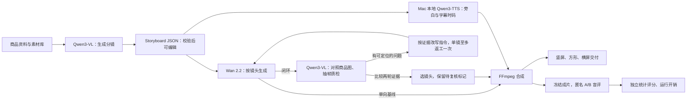

# MarketFilm：面向小商家商品素材的 AI 广告短视频工作台

> `storage/` 路径是项目作者的本地实验产物索引，Git 仓库不包含这些文件。按 [运行说明](README.md#从源码运行) 可生成自己的样片。

**结课验收稿 · 2026-11-21**

从商品图、已确认的卖点和受众出发，生成可编辑分镜和带中文旁白、字幕的多画幅广告。适用情境是商家只有商品图，想先做一条能复核、能修改、可分平台导出的样片。15 秒模式由片头、两个独立的 Wan 动态镜头（各约 3 秒）及其细节展示、片尾组成。系统和运行开销已实测；**截至本次复核，正式人工盲评为 0 份，画质收益尚未验证。**

## 多模型如何协作

- **Qwen3-VL 与 Wan 互补。** Qwen 规划分镜，基于商品图、五张抽帧和结尾检查给出可定位证据；Wan 负责把文本及图像条件生成视频。闭环改变的是具体镜头的提示词和最终取用的素材，返工前后的抽帧可以对照查看。证据不足时保留首轮；返工失败或两轮打分未改善时可回退。配音由独立的 Mac 本地神经语音模型负责，适配各段时长。
- **系统工程。** [分镜协议](protocol/storyboard.schema.json)校验镜头种类、提示词等字段，服务再检查时段结构；队列串行运行 GPU 任务并通过事件流显示进度。保存实际条件图、两轮原片、质检抽帧与选片理由。合成、换声、换画幅和批次 ZIP 复用已有镜头；历史实验的画面与评分映射不会随交付调整而变化。

## 实测：返工带来的时间和可观察结果

| 商品 | 单向基线 | 质检闭环 | 多用时间 | Wan 调用 | 返工取舍 |
| --- | ---: | ---: | ---: | ---: | --- |
| 蓝银有线鼠标 | 230.4 秒 | 377.3 秒 | 146.9 秒 | 2 → 3 | 第二镜采用返工；结尾能看到商品。 |
| 北屿随行杯 | 228.3 秒 | 378.6 秒 | 150.3 秒 | 2 → 3 | 第二镜返工后四项模型得分不变，保留首轮。 |

两组均使用 `ending-evidence-v2`。固定商品图、分镜、首轮指令、Seed、Wan 参数与配音；逐轨确认各组 A/B 使用相同音轨和字幕。时间为单任务生成及交付时间，不含队列；杯子的基线是事后补跑，闭环原始 381.2 秒扣除了 2.621 秒自动分镜。新增 Wan 调用时间折算分别约 **0.0307、0.0346 GPU 小时**；按自填小时单价换算金额，含等待和传输，不是卡上实际运行时间或账单。详见[两商品复验](EXPERIMENTS.md#同一版质检规则的两商品复验)、鼠标校验数据（`storage/reports/mouse-ending-audit-v2.json`）与随行杯校验数据（`storage/reports/cup-ending-audit-v2.json`）。

**画质怎么判断。** 相同 Seed 的独立运行首轮也可能不同，用独立运行记录真实成本。要隔离返工对画面的影响，用闭环任务自己的首轮镜头重合成，保持音轨、字幕与排版一致，再匿名对照闭环选片。新版杯子最终没有采用任何返工镜头，因此没有重复安排同内容的同源评分；离线包中的杯子是另外一组历史实验，与新版鼠标分别统计。等收到真实评分，再报告每组有效人数、三项均分及偏好票数。模型质检分只作过程证据。

## 结课演示顺序

1. 打开本地工作台 `http://127.0.0.1:5173`，在「填写需求」输入中文广告目标并生成 15 秒分镜。再从「运行记录」打开鼠标样片，进入「查看生成详情」，对照第二镜的首轮、返工和最终采用结果。用杯子样片展示系统也会回退首轮。
2. 打开「批量制作」的随行杯与鼠标批次，展示两条进度、复用的参考图、三种画幅和 ZIP 导出。可播放柔化补边后的随行杯（`storage/media/41399be0-2d18-4d68-810a-4b27f94e940a-soft-matte-original-9x16.mp4`）与鼠标（`storage/media/6b8136a5-624b-4493-8c07-f8670426fc6c-soft-matte-original-9x16.mp4`）；六条批量导出视频的验收（`storage/reports/batch-delivery-15/verified-batch-8443d8fa.json`）。
3. 展示「编辑配音」的逐镜试听。口播超长时先保留字幕；边界复验（`storage/reports/soft-matte-default.json`）中，缩短文案重新配音后三句均有声，画面视频流未变。三个画幅的音轨和字幕已逐轨核验。
4. 从「运行记录」打开随行杯的单镜修改版，点「对比修改前后」。用逐轨核验说明新版只重做了第二个动态镜头，保留其余原片、配音与字幕。
5. 打开「实验对照」，展示单向和闭环耗时；点「导出 Markdown 报告」下载实时统计。需现场盲评时，每位同学各发一个离线包：01（`storage/review-kits/round-04/双商品盲评-01.zip`） · 02（`storage/review-kits/round-04/双商品盲评-02.zip`） · 03（`storage/review-kits/round-04/双商品盲评-03.zip`）。解压打开 HTML，评完两组后只回传一个 JSON；作者在「实验对照 → 导入评分文件」录入。已验证断网播放、按组拆票及拒绝重复导入，测试记录未计入正式票数。

复现命令见 [README](README.md)。Wan 运行在现有 RTX 3090 上，分镜质检及配音在 Mac 运行，演示无需申请模型 API Key。
