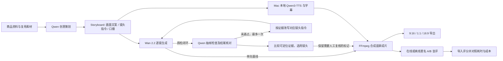

# MarketFilm · AI 广告短视频工作台

输入商品资料和参考图，输出可编辑分镜、带旁白和字幕的 7/15 秒短片。工作台展示逐镜生成、抽样质检、问题证据与返工轮次。项目的对照实验检验一个明确问题：冻结分镜后，加入 Qwen 质检与逐镜返工，成片质量和生成时间会怎样变化？



- 日常制作分为「填写需求 → 确认分镜 → 成片」三页。在第一步可以用中文写整条片的广告目标，例如“固定机位拍一只手提起随行杯，杯子始终完整入镜”。Qwen 将目标转成分镜指令；完整画面指令生成失败时会提示重试。运行记录独立打开，批量与实验在「更多」菜单。
- 成片页可进入「修改某个镜头」，用中文写修改意见。Qwen 只改这一镜的指令，Wan 只生成这一镜，再用原有其他镜头、配音和字幕合成新版本。完成后可在「对比修改前后」检查两个原片，或打开原版成片。人工修改版不计入课程 A/B 实验。
- 7 秒成片含一个 Wan 动态镜头，15 秒含两个独立动态镜头。默认每个原片 73 帧、24 fps，约 3 秒；片头、片尾和部分细节展示由合成补足。
- 策划和质检用 Qwen3-VL，可校验并编辑分镜；结构化输出失效时保留已验字段，缺失的画面指令先尝试重新生成，再按镜头回退到模板。质检先看五张抽帧，再单独把结尾抽帧与商品图对照，检查主体是否出画、被遮挡或变形。没有对应证据的低分标为「待核」，不能单独触发返工；结尾状态变差、已证实的指标退步或两轮证据不可比时保留首轮。生成过程可查看两轮原片、指令、取舍原因，点击证据即显示对应抽帧，并可另开对应原片。
- 遇到横图等非同画幅素材，先等比缩放并补边防止裁掉商品；在「成片 → 查看生成详情 → 素材与工作流 → 查看 Wan 实际参考帧」并排检查原图和模型输入。
- 旁白和画面文字独立可编辑，支持逐镜试听。普通话配音由本机 Qwen3-TTS 1.7B（MLX、8 bit）生成，FFmpeg 合成 AAC、MP4 可选字幕轨和 VTT。超长口播保留字幕并提示。在「成片 → 编辑配音」可改口播、选音色并生成新配音版，直接复制原视频轨，保留原版及实验样本。
- 新成片会检查 Wan 动态镜头中的纯色补边。仅当输入有记录的补边、并且抽低分辨率后逐帧确认边缘始终近似纯色时，才去掉大部分补边并用柔化背景补回画幅；不能确认就保留原画面。已有的带补边成片可在「其他画幅与版本」切换「原版／柔化补边」，不覆写原版和盲评样本。
- 在成片页的「其他画幅与版本」选择导出画幅。方形与横屏保留竖屏原片全幅，补背景并重排文字；复用已有原片、AAC 和字幕，无需再次调用 Wan。再次下载使用已生成版本。
- 在「批量制作」一次提交 2–8 件商品，每件单独分镜、单独进度，GPU 串行处理。图片存入本地素材库，重复图片按内容去重，可在创作或下一批次再次选择。批次记录可按画幅将已完成的 MP4 和现有 VTT 字幕一键下载成 ZIP；已重配音的商品使用最新版本，待复核成片会明确标记。
- 在「生成配置」选择 **A/B 对照**，一次创建基线和闭环任务，冻结同一输入与 Seed，随机安排运行先后。在「实验对照」为同一对成片创建独立的盲评链接或离线包；评阅人只看 A/B、参考图与确认卖点。每份只接受一次评分。作者界面可比较质量评分、调用次数、耗时和按输入单价估计的 GPU 成本。闭环实际采用了返工镜头时，还可点「制作同源对照」：用闭环任务留存的首轮镜头重合成，直接复制其音轨和字幕，比较替换镜头本身的影响。两类盲评分别汇总，只有独立运行组记录生成代价。

[结课报告与演示顺序](COURSE_REPORT.md) · [详细实验记录](EXPERIMENTS.md)

## 代码结构

- `src/App.jsx` 管理制作步骤和任务状态；`JourneyPages.jsx` 放成片和编辑页面，`ProcessWorkspace.jsx` 放生成详情与质检证据，`JobHistory.jsx` 放运行记录。
- `server/index.mjs` 管理 API、任务队列和媒体合成；`server/storyboard.mjs` 管理分镜策划与校验；`server/experiments.mjs` 管理实验对照与盲评。
- `protocol/` 是前后端共用的协议与示例数据；`scripts/` 是安装和验收脚本。`storage/` 保存本机素材、任务和评测产物，`.models/` 保存本机模型与环境。

## 从源码运行

安装 Node.js 22.12+，在本目录执行：

```bash
npm ci
cp .env.example .env
npm run dev
```

Windows PowerShell 用 `Copy-Item .env.example .env`。打开 `http://127.0.0.1:5173`。没装模型也能开工作台，用默认表单查看和编辑模板分镜；自定义创意、生成和质检需要相应模型。也可用 `npm run build` 后执行 `npm start`，通过 `http://127.0.0.1:4188` 同时访问页面和 API。端口可用 `.env` 的 `API_PORT` 改，Vite 代理自动使用相同值。

### 接入模型

| 功能 | 部署位置 | `.env` 配置 |
| --- | --- | --- |
| Wan 2.2 TI2V 5B | 任意可达的 ComfyUI，默认本机 `8188` | `WAN_COMFY_URL=http://127.0.0.1:8188`，或填写自己的服务地址 |
| Wan 经 SSH | 仅在远程服务器内网或回环口监听的 ComfyUI | 留空 `WAN_COMFY_URL`，设置 `WAN_SSH_HOST`（自己的 SSH 主机别名）和 `WAN_REMOTE_PORT`。先确认终端可以免交互连接；端口默认 `8188`。 |
| Qwen3-VL 策划、质检 | 已启动的视觉模型服务 | `PLANNER_BASE_URL=http://127.0.0.1:8080/v1`、`PLANNER_MODEL_ID`（服务 `/v1/models` 返回的 ID）。需要鉴权时私下设置 `PLANNER_API_KEY`。 |
| Qwen3-VL 策划、质检 | 本机由工作台启动 llama.cpp | 留空 `PLANNER_BASE_URL`；指定 `PLANNER_MODEL` 和 `PLANNER_MMPROJ`。`llama-server` 放在 `PATH`，或用 `PLANNER_BINARY` 指定。用 CPU 时设置 `PLANNER_GPU_LAYERS=0`。 |
| Qwen3-TTS 中文旁白 | Apple Silicon Mac，可选 | 运行 `sh scripts/setup-tts.sh`（Python 3.12、首次下载约 3.1 GB）。其他系统无需安装；保留「中文旁白与字幕」选项时仍会输出无配音的视频和字幕。已有配音环境可设置 `TTS_PYTHON`、`TTS_MODEL_PATH`。 |

- **Wan**：按 [ComfyUI 官方 5B 工作流](https://docs.comfy.org/tutorials/video/wan/wan2_2) 安装三个权重（放在运行 ComfyUI 的机器上）：`diffusion_models/wan2.2_ti2v_5B_fp16.safetensors`、`text_encoders/umt5_xxl_fp8_e4m3fn_scaled.safetensors`、`vae/wan2.2_vae.safetensors`。如已有同架构权重但文件名不同，可用 `WAN_UNET`、`WAN_TEXT_ENCODER`、`WAN_VAE` 对应 ComfyUI 下拉框里的名字。启动时会核对关键节点与权重，避免分镜编辑完才发现模型不兼容。`WAN_PRESET=quick` 可用于较短预览；正式 A/B 两组用同一设置。
- **远程部署**：可先在 GPU 机上自行启动 ComfyUI，再用直接地址或 SSH 接入。若希望工作台也负责启动，按模板同时配置三个 `WAN_REMOTE_*` 目录项；这一模式使用 Linux/NVIDIA。若用反向代理，请转发 ComfyUI 的 HTTP 与 WebSocket。工作台默认只监听本机。
- **Qwen**：本地复现可从 [llama.cpp](https://github.com/ggml-org/llama.cpp/releases) 安装 `llama-server`，从 [Qwen3-VL-2B-Instruct-GGUF](https://huggingface.co/Qwen/Qwen3-VL-2B-Instruct-GGUF/tree/main) 下载 Instruct 的模型 GGUF 和配套 mmproj。远程服务须提供 `/v1/models` 和支持图片与 JSON 结构化输出的 `/v1/chat/completions`；它会收到参考图、分镜和质检抽帧。仅连 Wan 可运行单向基线，闭环和单镜修改还需要 Qwen。
- **中文画面**：Linux 若缺字，请在运行工作台的机器安装 Noto CJK 字体（例如 Debian/Ubuntu 的 `fonts-noto-cjk`）。配音安装脚本可通过环境变量 `TTS_BOOTSTRAP_PYTHON` 选择 Python。

提交到 GitHub 时，本目录是仓库根目录。`.gitignore` 排除 `.env`、模型、依赖、构建目录和整份 `storage/`。`storage/` 中的成片、素材、运行记录和盲评文件保留在生成它们的电脑；克隆后会创建空历史。结课报告保留原实验数据与本地产物索引，Git 仓库不分发样片。需要查看完整功能可自行生成，或由项目作者另行分享指定成片或离线盲评包。

同学在自己的电脑上评分时，先选择对照组，点「下载离线盲评包」，为每位评阅人单独下载一份。评阅人用浏览器打开 HTML，完成后下载 JSON；你在同一工作台点「导入评分文件」即可一次录入多份。离线包已包含视频和参考图，不依赖本机在线。有多组时可展开「合并多组离线盲评」选择同类的 2–4 组，评阅人逐组评价、只回传一个 JSON；工作台仍按实际对照组分别计票。点击「导出 Markdown 报告」可下载最新快照；独立运行的耗时与成本、同源画质的实收票数分开列出。在线链接默认只在运行工作台的电脑可访问。

```bash
npm run build
npm run smoke
npm run test:narration
node scripts/verify-delivery.mjs http://127.0.0.1:4188 <已完成的15秒且带声字轨的任务ID>
node scripts/verify-shot-revision.mjs http://127.0.0.1:4188 <已完成且带声字轨的单镜修改版任务ID>
node scripts/verify-matte-delivery.mjs http://127.0.0.1:4188 <带补边和音字轨的历史任务ID>
node scripts/verify-batch-delivery.mjs http://127.0.0.1:4188 <已完成且有旁白的15秒闭环批次ID> <存有三个画幅ZIP的目录>
node scripts/verify-experiment.mjs http://127.0.0.1:4188 <15秒对照的基线ID> <闭环ID>
```

`smoke` 验证在线状态、7/15 秒分镜、请求边界和事件流，不调用 Wan 生成。`verify-delivery` 检查单条成片多画幅与音轨、字幕复用；`verify-batch-delivery` 核验整批三个 ZIP 与逐镜记录；`verify-experiment` 检查冻结输入、两轮取舍、实际片长、画面帧与音轨是否一致。[实测与评测说明](EXPERIMENTS.md)记录样片、耗时及尚未取得的证据。
